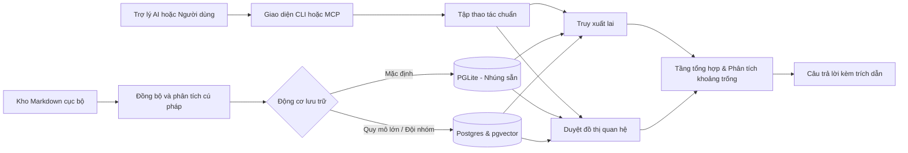

<h1><picture><source media="(prefers-color-scheme: dark)" srcset="docs/images/brand/gbrain-wordmark-light.svg"></picture></h1>

**Cung cấp cho trợ lý AI bạn đang dùng một bộ nhớ do chính bạn kiểm soát.** GBrain lưu trữ các dữ kiện rõ ràng kèm nguồn gốc trích dẫn, hỗ trợ chỉnh sửa hoặc thu hồi thông tin, và chia sẻ cùng một bộ nhớ xuyên suốt cho mọi trợ lý AI của bạn. Bắt đầu với bộ nhớ không cần API key và tìm kiếm theo từ khóa; mở rộng thêm tìm kiếm ngữ nghĩa (semantic search), tổng hợp câu trả lời và tự động làm giàu dữ liệu nền khi bạn cần.

GBrain được cấp phép theo chuẩn mã nguồn mở MIT và hoàn toàn miễn phí tự lưu trữ (self-host); [gbrain.io](https://gbrain.io) là dịch vụ lưu trữ đám mây có trả phí tùy chọn.

> [!TIP]
> **Cần bản lưu trữ sẵn (hosted)? Lần đầu sử dụng trợ lý AI?** Hãy trải nghiệm **[gbrain.io](https://gbrain.io/?ref=readme)** (bản GBrain đám mây) để có trải nghiệm dễ dàng nhất: một bộ não duy nhất cho bạn và đội ngũ của bạn, kết nối đồng thời với ChatGPT, Claude và Cursor, không cần cài đặt hay duy trì máy chủ trực tuyến. Bạn gặp khó khăn? Gửi email đến support@gbrain.io để được hỗ trợ thiết lập trực tiếp miễn phí.

**Đặt kỹ năng song hành cùng tri thức.** Các bộ não cục bộ mới được tạo sẽ tích hợp sẵn các kỹ năng ghi nhớ ngay tại thư mục nội dung gốc. Các trợ lý AI có thể tham gia vào danh mục kỹ năng được ủy quyền; chỉ những biên tập viên được phê duyệt mới có quyền xuất bản. Các bản cài đặt dành cho coding agent sẽ bổ sung một bộ định tuyến cục bộ có quyền sở hữu; khởi động lại và xác minh sử dụng thực tế là các bước riêng biệt. Xem thêm tại [kỹ năng dùng chung cho bộ não (shared brain skills)](docs/guides/shared-brain-skills.md).

## Chọn cách thiết lập của bạn

1. **Thêm GBrain vào trợ lý AI hiện có của tôi — Khuyên dùng.** Giữ nguyên danh tính và môi trường của trợ lý AI bạn đang dùng. Không yêu cầu tạo mới tài khoản hay kho lưu trữ (repository) riêng tư. Bắt đầu với hướng dẫn dành cho **[Grok Bot](docs/guides/grok-bot.md)**, **[Muse](docs/guides/muse.md)**, hoặc **[Codex / Claude Code](docs/tutorials/connect-coding-agent.md)**. [Các nền tảng khác](#kết-nối-gbrain-với-ứng-dụng-ai-của-bạn-mcp).
2. **Sử dụng bộ não trên máy tính cá nhân từ bất kỳ đâu.** Chỉ một dòng lệnh duy nhất để đưa bộ não lên mạng riêng Tailscale thông qua giao thức MCP và giữ nó luôn hoạt động: `gbrain mcp expose` (thêm `--funnel` cho các AI đám mây như Grok Bot, Muse và ChatGPT). Làm theo hướng dẫn **[dùng bộ não từ mọi nơi qua MCP](docs/guides/remote-mcp.md)**. **Nói với trợ lý của bạn:** *"use my brain over mcp"* — *"put my brain on tailscale"*.
3. **Kết nối với bộ não đám mây sẵn có.** Làm theo hướng dẫn **[truy cập bộ não đám mây](docs/guides/hosted-harness-access.md)** để chọn kết nối OAuth nguyên bản hoặc kết nối máy chủ nội bộ. Để đăng nhập trang quản trị, quản lý client và phân quyền, xem **[quản trị MCP](docs/mcp/ADMIN.md)** bằng thông tin xác thực quản trị viên riêng biệt.

Grok **Bot** và Grok **Build** là hai sản phẩm khác nhau. Trợ lý cá nhân của Muse và **Muse Code** cũng là hai sản phẩm riêng biệt. Muse đã có sẵn bộ nhớ cục bộ có thể chỉnh sửa; GBrain bổ sung thêm bản ghi rõ ràng, di động kèm nguồn gốc xác thực và khả năng chia sẻ. Xem các hướng dẫn chi tiết để biết bằng chứng kiểm thử và các bước xác minh.

---

Tôi là Garry Tan, Chủ tịch & CEO của Y Combinator. Tôi xây dựng GBrain để vận hành các trợ lý AI của chính mình. Đây là bộ não thực chiến đứng sau các triển khai OpenClaw và Hermes của tôi: **155.795 trang tài liệu, 24.589 người, 5.340 công ty**, cùng 66 tác vụ nền (cron job) chạy hoàn toàn tự động. Trợ lý của tôi tiếp nhận các cuộc họp, email, tweet, cuộc gọi thoại và các ý tưởng mới ngay cả khi tôi đang ngủ. Nó làm giàu thông tin về mỗi cá nhân và công ty nó bắt gặp, tự sửa các trích dẫn và củng cố trí nhớ qua đêm. Tôi thức dậy thông thái hơn lúc đi ngủ — và bạn cũng sẽ như vậy.

**GBrain cũng hoạt động như một bộ não dùng chung cho doanh nghiệp.** Các client từ xa đã xác thực sẽ bị giới hạn theo nguồn (source) và quyền thao tác, kết hợp với các bộ lọc hiển thị. Tập tin cục bộ và thông tin đăng nhập cơ sở dữ liệu dùng chung là một ranh giới bảo mật riêng biệt: chỉ riêng nguồn dữ liệu không cô lập được những người gọi đó. Đọc kỹ [ranh giới chia sẻ](docs/architecture/brains-and-sources.md#what-confines-remote-callers-and-what-does-not) và [hướng dẫn bộ não doanh nghiệp](docs/tutorials/company-brain.md) trước khi thiết lập quyền truy cập chung.

Bên cạnh việc truy xuất bằng từ khóa và ngữ nghĩa, GBrain cung cấp hai cách tùy chọn để khai thác kho tri thức đã lưu:

- **Một tầng tổng hợp mang lại câu trả lời thực tế.** Câu trả lời bằng văn xuôi tổng hợp, có trích dẫn rõ ràng xuyên suốt về con người, công ty, thương vụ và ý tưởng. Không phải kiểu "đây là 10 đoạn văn có chứa từ khóa của bạn", mà là một câu trả lời thực sự kèm nguồn trích dẫn và ghi chú rõ ràng về những gì bộ não **chưa biết**. Phân tích lỗ hổng thông tin (gap analysis) chính là yếu tố làm thay đổi hoàn toàn cách bạn sử dụng bộ não.
- **Một đồ thị tri thức có định kiểu (Typed Knowledge Graph).** Khi ghi trang cục bộ đáng tin cậy, hệ thống sẽ tự trích xuất các liên kết tham chiếu mà không cần gọi mô hình ngôn ngữ (LLM) nếu tính năng auto-linking được bật. Các liên kết từ xa qua `put_page` sẽ được cập nhật sau thông qua các lượt quét nền, bảo trì hoặc lệnh `add_link`. Khi hỏi "Ai đang làm việc tại acme-example?", đồ thị duyệt theo chiều rộng (breadth-first) chỉ mất vài mili-giây ngay cả trên các cụm liên kết dày đặc ([chi tiết kỹ thuật](docs/architecture/RETRIEVAL.md#breadth-first-graph-walks)). Trên bộ câu hỏi quan hệ BrainBench, việc truy xuất theo đồ thị giúp nâng chỉ số **R@5 từ 0.6626 lên 0.7241** ([benchmark](docs/architecture/RETRIEVAL.md#the-benchmark)).

Mục đích của việc xây dựng một bộ não 150.000 trang là tạo ra một "hào lũy chiến lược" (strategic moat). Bạn sẽ không bao giờ đánh mất ngữ cảnh. Bạn có thể truy vấn mọi thứ nằm trong đầu mình mà không cần đọc lại từ đầu. Tầng não bộ làm cho hào lũy này phát huy tác dụng. Chu kỳ "giấc mơ" 24/7 (dream cycle) giữ cho nó luôn sắc bén. Cả hai đều chạy trên phần cứng của bạn, cơ sở dữ liệu của bạn, và API key của chính bạn.

Việc chạy một dịch vụ nền (daemon) 24/7 để tiếp nhận, làm giàu và củng cố dữ liệu dễ dàng hơn nhiều so với việc bắt một trợ lý trò chuyện phải liên tục làm việc. GBrain chính là tiến trình nền đó được tổng quát hóa. Cài đặt trong 30 phút. Trợ lý của bạn làm phần việc còn lại. Khi trợ lý cá nhân của tôi thông minh hơn, trợ lý của bạn cũng vậy.

> **Bắt đầu không cần API key (Keyless).** Chi phí thuê bao trợ lý AI và chi phí gọi API mô hình bên ngoài là hai khoản riêng biệt. Việc khởi tạo trợ lý cá nhân tùy chọn mất khoảng 15 phút; tính năng làm giàu dữ liệu tự động 24/7 sẽ cần tài nguyên tính toán và khóa API riêng.

Các tùy chọn và sự kiện dài hạn có thể được chia sẻ giữa các trợ lý; trạng thái công việc tạm thời và cấu hình nền tảng sẽ được giữ cục bộ. Các nhà cung cấp đám mây về embedding, reranking, trích xuất và tổng hợp có thể nhận văn bản, và mô hình của trợ lý vẫn xem được ký ức đã nhớ lại ngay cả ở chế độ không dùng key. Xuất Markdown không thay thế cho bản sao lưu cơ sở dữ liệu hoàn chỉnh. Vui lòng đọc thêm [ranh giới bộ nhớ](docs/guides/memory-boundaries.md).

> **Dành cho LLM:** tải [`llms.txt`](llms.txt) để xem bản đồ tài liệu, hoặc [`llms-full.txt`](llms-full.txt) để xem toàn bộ tài liệu cốt lõi gộp trong một file. **Dành cho Agent:** bắt đầu với [`AGENTS.md`](AGENTS.md) (hoặc [`CLAUDE.md`](CLAUDE.md) nếu bạn dùng Claude Code).

---

## Trải nghiệm thực tế trông như thế nào?

Giả sử ngày mai bạn có một cuộc họp với Alice. Bạn muốn bước vào phòng họp và nhớ rõ cô ấy phụ trách mảng nào, lần gần nhất hai bên nói chuyện là khi nào, và có việc gì còn đang dang dở. Đây là những gì bạn gõ, và kết quả bạn nhận lại:

**Bạn hỏi:**

> "Tôi cần biết những gì trước cuộc họp với Alice vào ngày mai?"

**Hầu hết các công cụ quản lý tri thức cá nhân sẽ trả về một danh sách các trang tài liệu:** Kiểu như:

```text
1. people/alice — Alice phụ trách kỹ thuật tại Acme...
2. meetings/2026-03-15-alice-q1 — Đánh giá sản phẩm Q1 với Alice...
3. meetings/2026-01-08-acme-kickoff — Cuộc họp khởi động dự án với đội ngũ Acme...
4. customers/acme — Acme là công ty fintech vòng Series B mà chúng ta đang hợp tác...
5. notes/2026-04-22 — Trò chuyện nhanh với Alice về bảng giá...
```

Năm trang tài liệu mà bây giờ bạn phải tự bấm vào đọc từng trang để chuẩn bị. Công cụ tìm đúng tài liệu, nhưng nó không làm việc giúp bạn.

**GBrain trả về câu trả lời trực tiếp kèm nguồn dẫn:**

```text
Alice phụ trách kỹ thuật tại Acme (một công ty fintech vòng Series B). Lần gần nhất hai bên 
trao đổi là vào ngày 22 tháng 4 trong một cuộc gọi ngắn về bảng giá. Có 3 vấn đề vẫn 
đang chờ xử lý từ cuộc trò chuyện đó:

1. Alice nợ bạn bản đánh giá bảo mật cho gói dịch vụ mới 
   (hạn chót là ngày 1 tháng 5; chưa thấy cập nhật gì thêm).
2. Bạn đã cam kết gửi bảng giá cho gói 500 người dùng 
   (bạn đã gửi vào ngày 25 tháng 4; chưa thấy phản hồi).
3. Alice có nhắc họ đang tuyển Giám đốc An ninh thông tin (CISO); bạn nói sẽ giới thiệu 
   ứng viên phù hợp trong mạng lưới của bạn.

Lưu ý: Không có thông tin mới nào về Alice hay Acme được đưa vào bộ não kể từ ngày 22 tháng 4, 
tức 6 tuần trước. Có thể cô ấy đã trả lời qua email hoặc tin nhắn Slack riêng — các kênh 
mà bộ não chưa được kết nối tới. Bạn nên chủ động hỏi Alice để cập nhật tình hình trước 
khi coi những thông tin này vẫn còn hiệu lực.
```

Mỗi luận điểm đều có trang tài liệu gốc đứng sau. Phần "Lưu ý" ở cuối cho bạn biết những gì bộ não **chưa biết**, giúp bạn chủ động hỏi Alice thay vì bị bất ngờ. Bộ não vừa chuẩn bị xong cuộc họp cho bạn.

Đó là sự khác biệt giữa một **công cụ tìm kiếm** và một **bộ não**. Tìm kiếm chỉ đưa ra tài liệu. Bộ não đọc chúng thay bạn và viết ra câu trả lời.

---

## Cài đặt

> [!TIP]
> **Nhanh nhất: Dùng bản lưu trữ sẵn tại [gbrain.io](https://gbrain.io/cli?ref=readme) cho mọi nền tảng.** Chỉ cần một lệnh để khởi chạy GBrain đám mây trên gbrain.io; Claude Code, Codex, ChatGPT, Cursor và mọi AI khác đều có thể kết nối tới mà không cần bạn phải duy trì máy chủ trực tuyến.
>
> ```bash
> curl -sSL https://gbrainio.terminalwire.sh | bash
> gbrainio terminal connect      # mở trong một terminal mới
> gbrainio workspace new         # chọn gói dịch vụ trên trình duyệt
> curl -fsSL https://bun.sh/install | bash   # bỏ qua nếu đã cài Bun 1.4.4+
> export PATH="$HOME/.bun/bin:$PATH"
> bun install -g github:garrytan/gbrain#stable   # chỉ cài CLI gbrain; không chạy brain cục bộ
> # Dành cho Claude Code (giữ lại cấu hình gbrain cũ nếu có):
> (claude mcp get gbrain >/dev/null 2>&1 || claude mcp add --transport http --scope user gbrain https://gbrain.io/mcp) && gbrain setup claude-code --instructions-only
> # Dành cho Codex (giữ lại cấu hình gbrain cũ nếu có):
> (codex mcp get gbrain >/dev/null 2>&1 || codex mcp add gbrain --url https://gbrain.io/mcp) && gbrain setup codex --instructions-only
> ```
>
> Lệnh `gbrain setup <harness> --instructions-only` sẽ thông báo cho AI biết có sự hiện diện của bộ não (các agent hiếm khi tự gọi máy chủ MCP nếu không được dặn trước). Lệnh này sẽ ghi khối hướng dẫn ưu tiên não bộ ([brain-first block](docs/guides/setup.md#brain-first-instructions)) vào `~/.claude/CLAUDE.md` hoặc `AGENTS.md` của Codex và giữ nguyên cấu hình MCP.
>
> Bản cài đặt là một shell script dành cho macOS và Linux; bạn nên đọc trước khi chạy.

### Tự lưu trữ (Self-host) trên máy của bạn

GBrain được cấp phép mã nguồn mở theo chuẩn MIT và hoàn toàn miễn phí tự lưu trữ. Yêu cầu **Bun 1.4.4 trở lên**.

> [!WARNING]
> **GBrain KHÔNG phát hành qua npm.** Gói `gbrain` trên npm là một dự án hoàn toàn khác và có thể làm xung đột với tệp thực thi chính thức. Tuyệt đối không chạy `npm install -g gbrain` hoặc `bun add -g gbrain`. Chỉ cài đặt thông qua `bun install -g github:garrytan/gbrain#stable` hoặc `git clone --branch stable` + `bun install && bun link`. Cài nhầm? Chạy `gbrain doctor` để nhận hướng dẫn sửa.

```bash
bun install -g github:garrytan/gbrain#stable
gbrain setup claude-code              # hoặc: gbrain setup codex
gbrain init --pglite --no-embedding   # dành cho các nền tảng khác, hoặc chạy độc lập
```

Lệnh `gbrain setup` sẽ hiển thị trước những gì nó sắp ghi (`--dry-run` để xem trước, `--remove` để hoàn tác), tạo bộ não không cần key nếu chưa có, kết nối giao thức MCP, thiết lập hook và khối hướng dẫn ưu tiên bộ não cho trợ lý ([hướng dẫn thiết lập chi tiết](docs/guides/setup.md)). Với bất kỳ coding agent nào khác, bạn chỉ cần gửi lời nhắc:

```text
Add GBrain memory to this existing agent. Read and follow:
https://raw.githubusercontent.com/garrytan/gbrain/master/INSTALL_FOR_AGENTS.md
Keep my current identity and instructions, start keyless, and show me the
search-mode choice. Verify a remember/recall round trip with real GBrain calls.
```

Cấu hình Postgres, thin client, khóa API và nâng cấp: xem [docs/INSTALL.md](docs/INSTALL.md). Dành cho Agent: [INSTALL_FOR_AGENTS.md](INSTALL_FOR_AGENTS.md).

### Chạy CLI độc lập (Không cần trợ lý AI)

```bash
gbrain init --pglite --no-embedding   # không cần key, không cần server, không cần Docker
gbrain import ~/notes/ --no-embed     # đánh chỉ mục thư mục ghi chú markdown của bạn
gbrain search "một cụm từ trong ghi chú" --json
gbrain doctor                         # kiểm tra tình trạng sức khỏe hệ thống
```

### Tùy chọn: Khởi tạo một trợ lý cá nhân mới

Để GBrain tạo một **trợ lý cá nhân lâu dài mới** với đầy đủ tệp định danh và kho lưu trữ GitHub riêng tư, hãy mở Codex hoặc Claude Code trong một thư mục trống mới và nhập:

```text
Read and follow every step of:
https://raw.githubusercontent.com/garrytan/gbrain/stable/BOOTSTRAP_FOR_AGENTS.md
Goal: set yourself up as my persistent personal agent in this folder, with gbrain
as your memory. Interview me before writing any identity file — never invent
answers. Ask before anything destructive. You are not done until
`gbrain bootstrap verify` exits 0.
```

Xem thêm [hướng dẫn bootstrap](docs/guides/bootstrap.md). Đối với phiên bản chạy liên tục 24/7 (vừa tiếp nhận dữ liệu vừa thực hiện chu kỳ giấc mơ qua đêm trên máy chủ RAM 8GB+), hãy chạy GBrain dưới nền tảng [OpenClaw](https://github.com/openclaw/openclaw) hoặc [Hermes](https://github.com/NousResearch/hermes-agent) và đọc kỹ [hướng dẫn bộ não cá nhân](docs/tutorials/personal-brain.md).

### Kết nối GBrain với ứng dụng AI của bạn (MCP)

- **Client chạy stdio cục bộ:** `gbrain setup claude-code` hoặc `gbrain setup codex` sẽ đăng ký dịch vụ `gbrain serve`. Các client khác như Cursor, Windsurf sử dụng cú pháp: `"$(command -v gbrain)" serve --surface starter --advertise verbs`.
- **Plugin tích hợp sẵn kỹ năng:** Codex dùng `codex plugin marketplace add garrytan/gbrain@codex-plugin` + `codex plugin add gbrain@gbrain`; Claude Code dùng `/plugin marketplace add garrytan/gbrain` + `/plugin install gbrain@gbrain`.
- **Truy cập bộ não từ mọi nơi:** `gbrain mcp expose` để chia sẻ qua mạng Tailscale (`--funnel` dành cho các AI đám mây như Grok Bot, Muse và ChatGPT). [Xem hướng dẫn](docs/guides/remote-mcp.md).
- **Kết nối tới bộ não trên máy chủ khác:** `gbrain connect https://your-host/mcp --token gbrain_xxx --install`.

Hướng dẫn riêng cho từng ứng dụng: [Claude Code](docs/mcp/CLAUDE_CODE.md) · [Codex](docs/mcp/CODEX.md) · [ChatGPT](docs/mcp/CHATGPT.md) · [Claude Desktop](docs/mcp/CLAUDE_DESKTOP.md) · [Claude Cowork](docs/mcp/CLAUDE_COWORK.md) · [Perplexity](docs/mcp/PERPLEXITY.md) · [Hermes](docs/mcp/HERMES.md) · [OpenClaw](docs/mcp/OPENCLAW.md) · [opencode](docs/mcp/OPENCODE.md) · [Grok Build](docs/mcp/GROK.md) · [Grok Bot](docs/guides/grok-bot.md) · [Muse](docs/guides/muse.md) · [Tất cả về MCP](docs/mcp/README.md).

---

## Hai cách truy vấn bộ não của bạn

Truy xuất thô (như đa số các công cụ tri thức hiện nay) và tầng tổng hợp mang lại câu trả lời thực sự. Chúng phục vụ hai mục đích khác nhau:

```bash
# Truy xuất thô: Trả về danh sách trang khớp nhất theo điểm số lai (hybrid), không gọi LLM để viết câu trả lời
gbrain search "ai đang làm về AI agent ở các công ty trong danh mục đầu tư?"

# Tầng tổng hợp: Câu trả lời hoàn chỉnh kèm trích dẫn nguồn và phân tích lỗ hổng thông tin
gbrain think "ai đang làm về AI agent ở các công ty trong danh mục đầu tư?"
```

* **`gbrain search`**: Trả về các trang phù hợp nhất, xếp hạng bằng thuật toán kết hợp (vector + từ khóa + RRF + tăng cường theo nguồn + reranker). Dùng khi bạn cần tài liệu thô để đọc lướt, cấp ngữ cảnh cho AI, hoặc tra cứu trích dẫn.
* **`gbrain think`**: Thực hiện tìm kiếm tương tự, sau đó tự tổng hợp thành câu trả lời văn xuôi hoàn chỉnh kèm nguồn dẫn và chỉ ra rõ ràng những gì bộ não **chưa biết**. Khả năng phân tích khoảng trống thông tin chính là điểm khác biệt lớn nhất: câu trả lời sẽ cho bạn biết khi nào một tài liệu đã cũ, khi nào một thông tin chưa có nguồn, hoặc khi nào hai tài liệu mâu thuẫn với nhau.

**Bạn có thể nói với trợ lý AI của mình:** *"Chúng ta biết gì về acme-example?"* — *"Hãy tóm tắt về alice-example trước cuộc họp ngày mai"* — *"Tìm xem ai đang làm về AI agents."* Trợ lý sẽ tự động điều hướng các câu hỏi này tới bộ não; bạn không cần tự tay gõ lệnh.

---

## Cách đưa dữ liệu vào bộ não

Bắt đầu bằng một dữ kiện cụ thể hoặc một thư mục ghi chú; sau đó tùy chọn kích hoạt kết nối tự động, thu thập và làm giàu dữ liệu sau.

**Bạn đã có sẵn một kho tri thức công ty?** Hãy nói với trợ lý AI: *“Kết nối bộ não công ty sẵn có của chúng ta, giữ nguyên các tập tin, và hiển thị kế hoạch nhập dữ liệu trước.”* Bạn có thể thử nghiệm với `gbrain sources demo company-brain` mà không cần key hay dữ liệu riêng tư. Xem [hướng dẫn nạp dữ liệu công ty](docs/guides/company-brain-ingestion.md).

**Nói với trợ lý của bạn:** *"Ghi nhớ điều này kèm nguồn trích dẫn"* — *"Tôi nên nhập tài liệu nào vào trước?"*

Xem chi tiết tại [hướng dẫn nạp dữ liệu](docs/guides/data-ingestion.md) (bao gồm tệp tin, đoạn chat, kết nối dữ liệu Google và các lệnh thu thập).

---

## Cấu trúc hình thái bộ não (Schema packs)

Hầu hết các công cụ tri thức ép bạn vào một khuôn mẫu cố định: "ghi chú" + "con người" + "thẻ tag". Khi bạn đưa dữ liệu từ Notion hoặc kho Obsidian nhiều năm tuổi vào, AI sẽ lúng túng không hiểu thư mục `Projects/` là gì, hay `Reading/` là người hay là nguồn tài liệu.

**GBrain không áp đặt một cấu trúc cứng nhắc.** Nó đi kèm các bộ mẫu cấu trúc (schema packs) sẵn có và cho phép bạn tự định nghĩa bộ mẫu của riêng mình:

- **`gbrain-base-v2`** (Mặc định) — Phân loại chuẩn 15 loại tài liệu rõ ràng, không trùng lặp: `person` (người), `company` (công ty), `media`, `tweet`, `social-digest`, `analysis`, `atom`, `concept`, `source`, `deal` (thương vụ), `email`, `slack`, `writing`, `project`, và `note` (ghi chú chung).
- **`gbrain-base`** (Cũ) — Cấu trúc rộng hơn gồm 24 loại tài liệu. Được giữ lại để tương thích ngược.
- **`gbrain-recommended`** — Mở rộng từ `gbrain-base` với thêm 13 thư mục chuyên biệt (địa điểm, chuyến đi, hội thoại, cá nhân, dự án...).
- **Gói riêng của bạn** — Lệnh `gbrain schema detect` sẽ quét cấu trúc thư mục thực tế của bạn để đề xuất loại tài liệu phù hợp, `gbrain schema suggest` dùng AI tinh chỉnh đề xuất, và `gbrain schema review-candidates --apply` để bạn phê duyệt các loại bạn muốn dùng.

```bash
gbrain schema active                # xem gói schema nào đang chạy
gbrain schema list                  # danh sách các gói có sẵn và đã cài
gbrain schema detect                # tự động đề xuất loại tài liệu theo thư mục của bạn
gbrain schema suggest               # AI gợi ý tinh chỉnh thêm
gbrain schema review-candidates     # con người duyệt: chấp nhận / đổi tên / bỏ qua
gbrain schema use my-pack           # kích hoạt gói của bạn
```

---

## Hướng dẫn thực hành (Tutorials)

Các bài hướng dẫn từng bước từ số 0 đến khi hoàn thiện:

- [**Thiết lập trợ lý AI cá nhân + bộ não từ đầu**](docs/tutorials/personal-brain.md) — Bản cài đặt chuẩn hoàn chỉnh: 2 kho GitHub, bot Telegram, OpenClaw + GBrain + Supabase. Hoàn thành trong khoảng 2 giờ.
- [**Thiết lập GBrain làm bộ não cho công ty**](docs/tutorials/company-brain.md) — Bộ nhớ tổ chức dùng chung, đa người dùng, phân quyền OAuth cho nhóm 10–50 người. Hoàn thành trong khoảng 90 phút.
- [**Tự động nâng cấp kỹ năng với `gbrain skillopt`**](docs/tutorials/improving-skills-with-skillopt.md) — Tinh chỉnh tệp `SKILL.md` như một tham số huấn luyện, tự động đo lường và cải thiện chất lượng kỹ năng.

Xem toàn bộ danh mục tại: [`docs/tutorials/`](docs/tutorials/).

---

## Vòng lặp vận hành (The loop)

```text
  Tín hiệu   →   Tìm kiếm    →   Phản hồi    →     Ghi nhớ    →   Liên kết tự động  →  Đồng bộ
(Mỗi tin nhắn) (Ưu tiên não bộ) (Dựa trên ngữ cảnh) (Trang + Mốc tg) (Đồ thị quan hệ)   (Tác vụ nền)
```

- **Bộ dò tín hiệu (Signal detector):** Sau khi bạn cho phép, hệ thống tự động ghi nhận các ý tưởng lâu dài và thực thể từ những tin nhắn quan trọng.
- **Truy xuất ưu tiên não bộ (Brain-first lookup):** Kiểm tra bộ não trước bất kỳ lệnh gọi API bên ngoài nào. Đây là nguồn thông tin nhanh nhất, rẻ nhất và mang tính cá nhân nhất mà bạn có.
- **Liên kết tự động (Auto-link):** Tự động bóc tách các liên kết dạng đồ thị khi ghi tài liệu cục bộ mà không tốn chi phí gọi LLM.
- **Làm giàu thông tin bằng Cron:** Tự động chạy khi bạn ngủ: lọc trùng các trang thông tin về con người, sửa trích dẫn, phát hiện mâu thuẫn, chuẩn bị danh sách công việc cho ngày mai.

**Bạn có thể nói với trợ lý:** *"Set up autopilot"* (cài đặt cron tự động) — *"Run dream"* (chạy chu kỳ củng cố trí nhớ) — *"Did the dream cycle run?"*.

---

## Tích hợp

Dữ liệu đưa vào bộ não thông qua các công thức mẫu (recipe) tại thư mục `recipes/`:

- **Giọng nói (Voice):** Chuyển các cuộc gọi điện thoại thành ghi chép trong não bộ qua Twilio + OpenAI Realtime. Chi tiết: [`recipes/twilio-voice-brain.md`](recipes/twilio-voice-brain.md).
- **Gmail + Lịch + Danh bạ Google:** Đồng bộ luồng thư, lịch hẹn, danh bạ qua OAuth cá nhân (`gbrain waiting`). Chi tiết: [`docs/guides/google-connect.md`](docs/guides/google-connect.md).
- **Ghi chép cuộc họp + Kênh Slack:** Hỗ trợ nạp biên bản họp (Fireflies) và kênh trao đổi Slack theo lịch trình. Chi tiết: [`docs/guides/meeting-and-slack-sources.md`](docs/guides/meeting-and-slack-sources.md).
- **Nhà cung cấp Embedding:** Hỗ trợ Voyage (mặc định: `voyage-4`), OpenAI, OpenRouter, Google Gemini, Azure OpenAI, Ollama (chạy offline cục bộ), v.v. Bảng giá và hướng dẫn tại [`docs/integrations/embedding-providers.md`](docs/integrations/embedding-providers.md).
- **Reranker:** Hỗ trợ Voyage `rerank-3-lite` hoặc giải pháp chạy offline hoàn toàn bằng mô hình nội bộ qua llama.cpp ([hướng dẫn](docs/ai-providers/llama-server-reranker.md)).
- **Két lưu trữ thông tin đăng nhập (Credential vault):** Lệnh `gbrain creds` quản lý an toàn các khóa OAuth và API tại máy cục bộ.
- **Client MCP:** Hỗ trợ tất cả các ứng dụng MCP phổ biến hiện nay.
- **Memorable (Bộ nhớ quy trình — Tùy chọn):** Bộ não nhớ *điều gì* đã diễn ra; Memorable giúp AI nhớ *cách thức* làm — các phiên lập trình đã hoàn thành trở thành các quy trình có thể tái sử dụng. Chi tiết: [`docs/memorable-agents.md`](docs/memorable-agents.md).

---

## Kiến trúc hệ thống



- **Hai động cơ, cùng một chuẩn giao tiếp:** PGLite (Postgres nhúng chạy trực tiếp, không cần cài đặt máy chủ) dành cho bộ não cá nhân lên tới ~50.000 trang. Postgres + pgvector dành cho hệ thống lớn hoặc dùng chung nhiều máy.
- **Tập tin Markdown là nguồn gốc sự thật (Source of truth):** Thư mục chứa các tệp Markdown; cơ sở dữ liệu đóng vai trò là chỉ mục có thể xây dựng lại bất cứ lúc nào từ các tệp này.
- **Hai trục tổ chức độc lập:** **Brain** (xác định Cơ sở dữ liệu nào) và **Source** (xác định Kho lưu trữ nào bên trong cơ sở dữ liệu đó).
- **Sức mạnh của Đồ thị:** Tìm kiếm vector giúp tìm các đoạn văn có nội dung tương đồng; duyệt đồ thị giúp lần theo các mối quan hệ thực tế giữa con người, sự kiện và tổ chức.

---

## Khắc phục sự cố

Bắt đầu bằng lệnh `gbrain doctor`. Đối với các sự cố truy cập cơ sở dữ liệu, hãy dùng `gbrain engine status --probe` và `gbrain db-repair` trước khi thay đổi cấu hình.

**Nói với trợ lý AI:** *"Kiểm tra tình trạng bộ não và cho tôi xem kế hoạch sửa lỗi trước khi thay đổi bất kỳ điều gì."*

Xem thêm [tài liệu khắc phục sự cố](docs/guides/troubleshooting.md).

---

## Tài liệu tham khảo

- [`docs/INSTALL.md`](docs/INSTALL.md) — Chi tiết mọi phương thức cài đặt
- [`docs/guides/bootstrap.md`](docs/guides/bootstrap.md) — Quy trình khởi tạo trợ lý cá nhân
- [Cấu trúc một trang tri thức](docs/guides/page-anatomy.md) — Frontmatter, mốc thời gian và dữ kiện
- [`docs/what-schemas-unlock.md`](docs/what-schemas-unlock.md) — Vì sao cấu trúc schema lại quan trọng
- [`docs/architecture/`](docs/architecture/) — Thiết kế kiến trúc và lý thuyết truy xuất
- [`docs/guides/`](docs/guides/) — Sổ tay vận hành (kết nối Google, bóc tách ý tưởng, xử lý dữ liệu...)
- [`docs/integrations/`](docs/integrations/) — Kết nối nguồn dữ liệu ngoài
- [`docs/mcp/`](docs/mcp/) — Thiết lập giao thức MCP cho từng client
- [`AGENTS.md`](AGENTS.md) — Hướng dẫn vận hành dành cho các Agent không phải Claude
- [`CLAUDE.md`](CLAUDE.md) — Hướng dẫn vận hành chi tiết dành cho Claude Code
- [`CONTRIBUTING.md`](CONTRIBUTING.md) — Hướng dẫn đóng góp mã nguồn
- [`SECURITY.md`](SECURITY.md) — Mô hình bảo mật và an toàn dữ liệu

---

## Đóng góp phát triển

Chạy `bun run test` để chạy nhanh kiểm thử, `bun run verify` trước khi push code, `bun run ci:local` để chạy toàn bộ quy trình CI bằng Docker tại máy cục bộ. Chi tiết xem tại [`CONTRIBUTING.md`](CONTRIBUTING.md).

---

## Giấy phép & Tác giả

Phát hành theo giấy phép **MIT**. Được xây dựng bởi Garry Tan để vận hành hệ thống AI cá nhân.

Câu chuyện nguồn gốc: [`docs/ethos/ORIGIN.md`](docs/ethos/ORIGIN.md).
